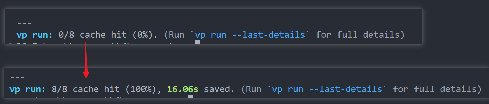
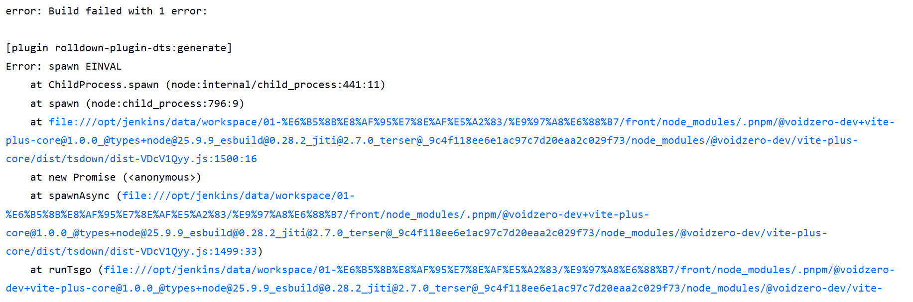

用官方给的 prompt 让 AI 进行整体迁移，还是比较轻松的。

由于已有的 turborepo 项目大量使用了 vite 系列的工具链，已有架构是：turbo + vite + tsdown + oxfmt + oxlint + vitest + lefthook 的 monorepo 项目。其实很早就在关注 vite+ 了，但是在 1.0 发布之前，并不想去试验，毕竟涉及到架构的改造，而且 0.x 版本会有频繁的变动，所以就没折腾，1.0 发布之后才开始进行迁移工作。

## Table of contents

## 迁移前的注意事项

1. 使用 `vite-plus` 并不一定要安装全局的 vite+，只是 vite+ 会提供更多的命令而已
2. 在已有项目中，`vite-plus` 这个 npm 包本身就以及涵盖了大部分开发常用命令。在保持项目环境的同时，并不会对其他团队成员的开发造成额外任何的负担

## 基础迁移

所有的配置，不管是 tsdown 还是 vitest 还是 oxfmt 等，都只需要一个 `vite.config.ts` 文件来完成配置，只说大概流程，具体细节不赘述。

1. 安装 `vite-plus`，同时移除 oxlint oxfmt tsdown
2. 在项目根目录创建 `vite.config.ts` 并将 oxlint 和 oxfmt 的配置分别迁移到 `lint` `fmt` 中。
   1. 这里有一个需要注意的，`vite-plus` 暂时不支持外部引入的配置动态更新
   2. 比如 oxfmt 的配置是通过 `import fmtRules from './fmr-rules.ts'` 合并的，但是更改 fmtRules 的内容，并不会使 oxc 插件重新扫描最新的规则，虽然规则生效，但是编辑器上依然显示错误，必须重启编辑器
3. 将 tsdown 配置迁移到 `pack` 中，`vitest` 配置迁移到 `test` 中
4. 移除 lefthook，使用 `pnpm exec vp hooks enable`（若没有安装全局 vp） 开启 .vite-hooks 钩子，并将校验钩子命令迁移到 `staged` 中。
5. 项目中的 vite 插件需要使用 `vite-plus` 导出的 `lazyPlugins` 函数来注册，同时其他由 vite 导出的 API 也由 `vite-plus` 接管。

```ts
export default defineConfig({
  plugins: lazyPlugins(() => [
    // ...
    react({ compiler: true }),
  ]),
});
```

## vite task

vite task 就是用来替代 turborepo 的。个人感觉相比 turborepo，vite task 的功能并没有那么丰富，不过对于开发来说是足够了。

首先需要了解 vite+ 中的任务缓存方式，

- `vp run dev` 和 `vp dev` 的区别是：`vp run dev` 会缓存任务结果，而 `vp dev` 则不会，也可以理解为，通过 run 执行的任务才会被缓存。
- 在 task 中配置的任务名称不能和 `scripts` 中定义的任务名称重复，这点和 turborepo 刚好是相反的

在 turbo.json 中，执行 `turbo run build` 就会递归执行 scripts 名称为 `build` 任务，并对任务进行缓存。

```json
{
  "tasks": {
    "build": {
      "dependsOn": ["^build"]
      // ...
    },
    "dev": {
      "cache": false,
      "persistent": true
    }
  }
}
```

在 vite-plus 中，如果想要缓存 scripts 中的任务，需要先开启 `cache` 缓存

```ts
export default defineConfig({
  run: {
    // 为 true 时，默认开启了 scripts 中的任务缓存 和 tasks 中自定义的任务缓存
    cache: true, // 开启缓存
    tasks: {},
  },
  test: {},
  staged: {},
  fmt: {},
  lint: {},
});
```

比如一个项目 web 依赖了多个 workspace 依赖， 而 web 项目和 workspace 项目都定义了 `build: vp build` 任务，想要启动 web 项目的 build 任务且带有缓存功能，在根目录的 `scripts` 中添加 vp 命令即可。

```json
{
  "scripts": {
    "dev:web": "vp run --filter=@example/web... --parallel dev",
    "build:web": "vp run --filter=@example/web... build"
  }
}
```

执行 `pnpm build:web`，vite task 会自动根据依赖关系进行构建，并缓存任务，连续两次执行同一任务，如图所示



### 自定义任务缓存

由于 vite-plus 自带了 check 和 test 命令，因此可以直接通过 `vp test` `vp check` 来运行。但是直接执行这两个命令是没有缓存的，因为不再 scripts 中，因此需要额外包一层 task

```ts
export default defineConfig({
  run: {
    cache: true,
    tasks: {
      "check:cached": {
        command: "vp check",
        cache: { output: [] },
      },
    },
  },
  test: {},
  staged: {},
  fmt: {},
  lint: {},
});
```

对应的 scripts 中添加如下内容，此时执行 `pnpm check` 就有缓存效果了，如果想要自动修复则 `pnpm check --fix` 即可，test 同理。

```json
{
  "scripts": {
    "check": "vp run check:cached"
  }
}
```

## 问题汇总

### 关于在 jenkins 上 rolldown-plugin-dts 问题

暂时只发现一个问题，不确定是 tsdown 本身的问题还是 vite-plus 内置的 tsdown 问题，因为之前在 turbo 上是正常的。

有点奇怪的是：在我本地的 windows 上是可以正常构建的，但是 Jenkins 上却报如下错误：



既然是 `dts` 生成的问题，那我在构建的时候不生成 dts 就可以了，比较生产构建 dts 也没什么意义，将 `dts: true` 改为 `dts: "local-only"` 仅在本地生成 dts 就解决了。虽然不清楚问题所在，但是好使就行。
