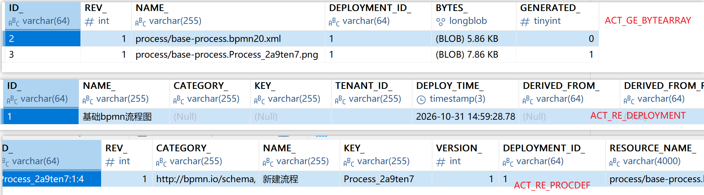
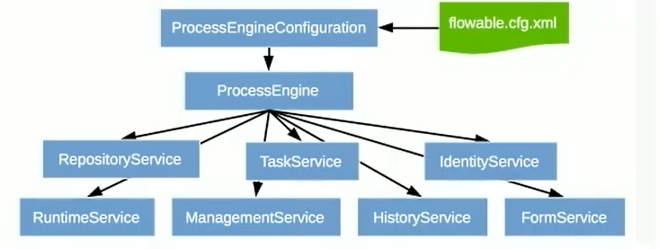
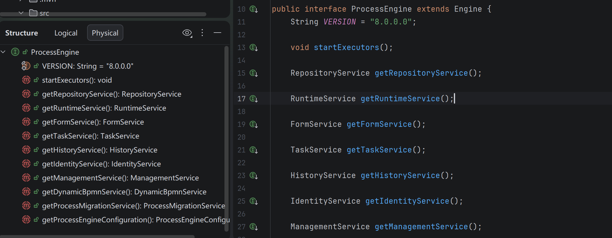
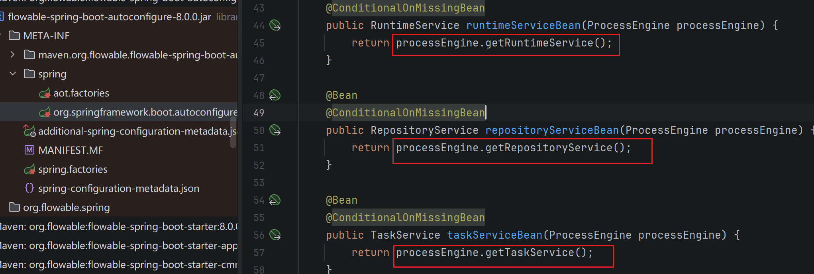
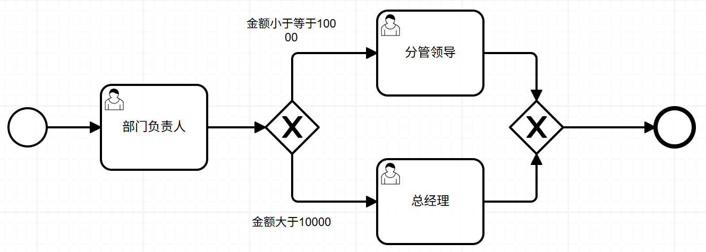
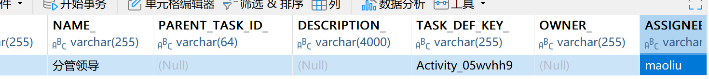
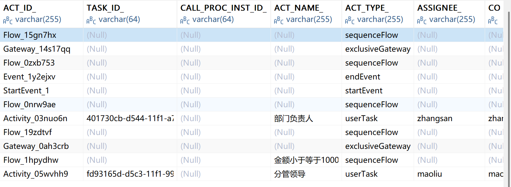
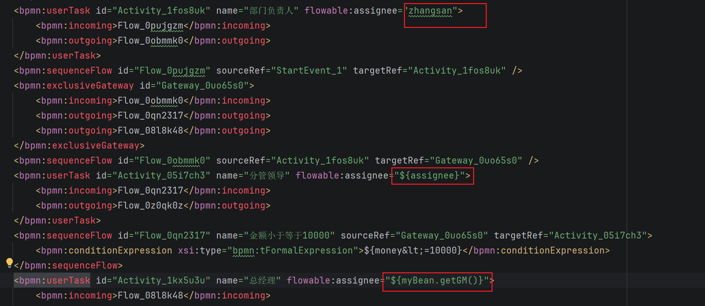

基于 springboot 4.x + flowable 8.0 - 基础入门

## Table of contents

## 最小化基础流程部署

准备 mysql，导入 flowable 全量 maven 依赖（可按需导入，具体自行查阅官方文档）运行项目

```xml
<dependency>
    <groupId>org.flowable</groupId>
    <artifactId>flowable-spring-boot-starter</artifactId>
    <version>8.0.0</version>
</dependency>
```

最小化启动（不依赖 springboot 启动），pbmn 流程 xml 可使用 [vue-bpmn-designer](https://tsai996.github.io/vue-bpmn-designer/) 或者 [bpmn-js 官方](https://demo.bpmn.io/new) 临时导出，感谢各位的开源。

```java
public class PureJavaFlowable {
    // 连接的 url 需要添加 nullCatalogMeansCurrent=true 才能在表结构不存在的情况下自动新建表
    private static final String url = "jdbc:mysql://192.168.52.128:3306/flowable-learn?useSSL=false&serverTimezone=Asia/Shanghai&characterEncoding=utf8&allowPublicKeyRetrieval=true&nullCatalogMeansCurrent=true";

    @Test
    void PureDeployFlowable() {
        // 流程引擎配置对象，关联相关的数据源
        ProcessEngineConfiguration configuration = new StandaloneProcessEngineConfiguration()
                .setJdbcUrl(url)
                .setJdbcDriver("com.mysql.cj.jdbc.Driver")
                .setJdbcUsername("root")
                .setJdbcPassword("123456")
                // - DB_SCHEMA_UPDATE_TRUE 引擎启动时，检查并在需要时更新表结构，表不存在则创建
                // - DB_SCHEMA_UPDATE_FALSE （默认）引擎启动时，检查数据库结构的版本是否匹配当前使用版本，不匹配则抛出异常
                // - DB_SCHEMA_UPDATE_CREATE_DROP 引擎启动时，创建表，关闭时，删除表
                .setDatabaseSchemaUpdate(ProcessEngineConfiguration.DB_SCHEMA_UPDATE_TRUE);

        // 获取流程引擎对象
        ProcessEngine processEngine = configuration.buildProcessEngine();
        // 部署流程需要获取 RepositoryService
        RepositoryService service = processEngine.getRepositoryService();
        Deployment deploy = service.createDeployment()
                .addClasspathResource("process/base-process.bpmn20.xml")
                .name("基础bpmn流程图")
                .deploy();

        System.out.println("deployId: " + deploy.getId()); // deployId: 1
    }
}
```

执行后可在数据表中查阅一下表的数据

- `ACT_GE_BYTEARRAY`：记录流程定义的资源数据表，xml 和流程图的图片信息
- `ACT_RE_DEPLOYMENT`：流程部署表，记录此次的部署行为
- `ACT_RE_PROCDEF`：流程定义表，记录此次部署对应的流程定义信息



> 部署 deploy 和流程定义 processDefine 的区别：一次部署可以部署多个流程定义，多个同时部署时，这些流程对应的部署 ID 是相同的。

## 表基础结构了解

这个应该结合后续的发起审批、任务流转来看，直接看应该看不懂。

- `ACT_RE`：`RE` 表示 repository，包含了流程定义和流程的静态资源（图片、规则等等）
- `ACT_RU`：`RU` 表示 runtime，包含了流程实例、任务、变量、异步任务等运行中的数据，flowable 仅会在流程执行过程中存储，流程结束会自动删除相关数据，可以确保运行时表的占用空间更小。
- `ACT_HI`：`HI` 表示 history，包含流程的历史数据（流程实例、变量、任务等等）
- `ACT_GE`：`GE` 表示 general，通用数据。
- `ACT_ID`：`ID` 表示 identity，包含用户、组、角色、授权等等（基本不用）

| 表分类       | 表名                | 说明                                                 |
| ------------ | ------------------- | ---------------------------------------------------- |
| 一般数据     |                     |                                                      |
|              | ACT_GE_PROPERTY     | 系统相关属性                                         |
|              | ACT_GE_BYTEARRAY    | 通用的流程部署和流程资源存储                         |
| 流程历史数据 |                     |                                                      |
|              | ACT_HI_ACTINST      | 历史流程实例（最粗粒度仅记录流程开始和结束时间）     |
|              | ACT_HI_PROCINST     | 历史流程实例（最细粒度各节点包含线、分支条件等）     |
|              | ACT_HI_TASKINST     | 历史任务实例（中等粒度，记录任务节点信息，不包含线） |
|              | ACT_HI_VARINST      | 历史流程运行中的变量信息                             |
|              | ACT_HI_ATTACHMENT   | 历史流程附件                                         |
|              | ACT_HI_COMMENT      | 历史说明性信息                                       |
|              | ACT_HI_DETAIL       | 历史流程运行中的细节信息                             |
|              | ACT_HI_IDENTITYLINK | 历史流程运行中的用户关系                             |
| 流程定义表   |                     |                                                      |
|              | ACT_RE_DEPLOYMENT   | 记录此次的部署行为（一次可部署多个流程定义）         |
|              | ACT_RE_MODEL        | 模型信息                                             |
|              | ACT_RE_PROCDEF      | 已部署的流程定义                                     |
| 运行实例表   |                     |                                                      |
|              | ACT_RU_EVENT_SUBSCR | 运行时事件                                           |
|              | ACT_RU_EXECUTION    | 运行时流程执行实例                                   |
|              | ACT_RU_IDENTITYLINK | 运行时用户关系，存储任务节点参与者相关信息           |
|              | ACT_RU_JOB          | 运行时作业                                           |
|              | ACT_RU_TASK         | 运行时任务                                           |
|              | ACT_RU_VARIABLE     | 运行时的实例变量                                     |

用户表用户组不使用，因为正常项目开发不会使用 flowable 来创建和管理用户。

### 部署

部署后相关的表：`ACT_RE_DEPLOYMENT` `ACT_GE_BYTEARRAY` `ACT_RE_PROCDEF`，其中 deployment 和 processdef 是一对多的关系，一次部署可以部署多个流程定义

### 流程启动

当启动一个流程实例后，会在 `ACT_RU_*` 对应的表中操作，运行时实例涉及以下 10 张表：

- `ACT_RU_DEADLETTER_JOB` 正在运行中的任务
- `ACT_RU_EVENT_SUBSCR` 运行时事件
- `ACT_RU_EXECUTION` 运行时流程实例
- `ACT_RU_HISTORY_JOB` 历史作业表
- `ACT_RU_IDENTITYLINK` 运行时用户关系
- `ACT_RU_JOB` 运行时作业
- `ACT_RU_TASK` 运行时任务
- `ACT_RU_VARIABLE` 运行时变量
- `ACT_RU_SUSPENDED_JOB` 暂停的作业表
- `ACT_RU_TIMER_JOB` 定时任务表

当一个流程实例启动时，直接会影响到的表有 `ACT_RU_EXECUTION` `ACT_RU_TASK` `ACT_RU_VARIABLE` `ACT_RU_IDENTITYLINK`

### 流程结束

当流程完成时，`ACT_RU_*` 相关表的数据就会被清空掉，因为已经不属于运行时了，相对的，可以在 `ACT_HI_*` 相关表进行查询，具体可见上方的表结构

## SpringBoot 流程部署

```yaml
server:
  port: ${SERVER_PORT:9999}
spring:
  application:
    name: flowable-learn-java
  datasource:
    url: ${FLOW_DB_URL:jdbc:mysql://192.168.52.128:3306/flowable-learn?useSSL=false&serverTimezone=Asia/Shanghai&characterEncoding=utf8&allowPublicKeyRetrieval=true&nullCatalogMeansCurrent=true}
    username: ${FLOW_DB_USERNAME:root}
    password: ${FLOW_DB_PASSWORD:123456}
    driver-class-name: com.mysql.cj.jdbc.Driver
    type: com.alibaba.druid.pool.DruidDataSource

flowable:
  database-schema-update: true
  async-executor-activate: false # 关闭定时任务

logging:
  level:
    org:
      flowable: debug
```

```java
@SpringBootTest
class FlowableLearnJavaApplicationTests {

    // @Autowired
    // private ProcessEngine processEngine;

    @Autowired
    private RepositoryService service;

    // 部署流程实例
    @Test
    void deployFlow() {
        // RepositoryService service = processEngine.getRepositoryService();
        Deployment deploy = service.createDeployment()
                .addClasspathResource("process/base-process.bpmn20.xml")
                .name("基础bpmn流程图")
                .deploy();
        System.out.println("deployId: " + deploy.getId()); // deployId: 1
    }
}
```

## flowable service 的设计模式

所有的 service 都可以从 ProcessEngine 中获取，也可以通过 @Autowired 直接注入相关容器



基于源码也可以看到能够获取到的 service



本质上内部也是调用的这些 getService() 方法



## 启动已部署的流程实例

- 其中 processId 为 `ACT_RE_PROCDEF` 表中的 `ID_` 列的值，processKey 为 `ACT_RE_PROCDEF` 表中的 `KEY_` 列的值。
- processKey 在前端绘制流程图时，可以手动指定，不指定则 bpmn-js 会自动生成，手动指定时，要保证 key 的唯一性。

```java
@SpringBootTest
class FlowableLearnJavaApplicationTests {
    @Autowired
    private RuntimeService runtimeService;

    // 启动流程实例
    @Test
    void startFLow() {
        // 流程中的分支条件
        Map<String, Object> variables = new HashMap<>();
        variables.put("money", 500);

        String processId = "Process_2a9ten7:1:39d9dc9b-d543-11f1-982b-00e04c3600d6";
        String processKey = "Process_2a9ten7";
        // 根据流程实例 id 启动流程实例
        ProcessInstance processInstance = runtimeService.startProcessInstanceById(processId, variables);
        // 或者 根据流程实例 key 启动流程实例
        // runtimeService.startProcessInstanceByKey(processKey);
    }
}
```



基于当前的流程设计图，启动流程实例后，就会走到 “部门负责人 张三” 处，此时可以观察以下几张数据表等等（有好多张表）

- `ACT_RU_TASK`：当前位于节点的信息，流转时，删除当前节点，插入下一个节点。流程结束时，彻底删除
- `ACT_RU_EXECUTION`：流程发起时，插入两条（一根一子，并行网关是一根二子），其中根不变，子始终指向当前的活跃节点。流程结束时，彻底删除
- `ACT_RU_VARIABLE`：流程实例的变量信息。流程结束时，删除
- `ACT_HI_PROCINST`：最粗粒度的流程实例信息，记录流程实例的开始和结束时间等
- `ACT_HI_ACTINST`：最细化的流程的完整轨迹（开始节点 → 连线 → 部门负责 ...）

流程定义和流程实例的区别：

- 流程定义：类似 Java 中的类，即流程的部署
- 流程实例：类似 Java 中的对象，即流程的启动（发起），可以根据一个流程定义启动很多个流程实例

## 获取审批任务

比如要获取某人的待审批任务

```java
@SpringBootTest
class FlowableLearnJavaApplicationTests {
    @Autowired
    private TaskService taskService;

    // 查询流程中的用户
    @Test
    void findUserFlowInfo(){
        // 任务实例操作都是通过 taskService 实现
        // 获取到 ACT_RU_TASK 中 assignee 字段是 zhangsan 的记录
        List<Task> tasks = taskService.createTaskQuery()
                .taskAssignee("zhangsan") // 指定查询条件
                .list();
        /**
         * ==> Preparing: SELECT RES.* from ACT_RU_TASK RES WHERE RES.ASSIGNEE_ = ? order by RES.ID_ asc
         * ==> Parameters: zhangsan(String)
         * <==      Total: 1
         * [Task[id=401730cb-d544-11f1-a7dc-00e04c3600d6, key=Activity_03nuo6n, name=部门负责人, processInstanceId=4013fc74-d544-11f1-a7dc-00e04c3600d6, executionId=4014bfc7-d544-11f1-a7dc-00e04c3600d6, processDefinitionId=Process_2a9ten7:1:39d9dc9b-d543-11f1-982b-00e04c3600d6]]
         */
        System.out.println(tasks);
    }
}
```

## 完成审批任务

流转到下一阶段

```java
// 任务审批处理
@Test
void completeTask(){
    // 根据 taskId 完成审批
    taskService.complete("401730cb-d544-11f1-a7dc-00e04c3600d6"); // taskId
}
```

此时再观察 `ACT_RU_TASK` 表，会发现数据变成了下一个节点的信息，而且 taskId 也变了，说明当前节点完成后已删除，流转到下个节点时插入了一个新的节点数据



再将新的 taskId 完成，此流程就结束了，此时 `ACT_RU_TASK` 表数据的相关数据就清空了，而在 `ACT_HI_ACTINST` 可以看到完整的流程走向。



## 流程的挂起和激活

部署后的流程默认是激活状态，如果暂时不想使用此流程，可以将流程定义进行挂起，无法启动新的流程任务，**但是不会影响已经启动的流程实例**。

```java
// 流程的挂起和激活 流程定义肯定是单个的，将流程定义挂起，也就挂起了基于此定义的所有任务
@Test
void suspendedTask() {
    // ACT_RE_PROCDEF 表中的 ID_
    String defId = "Process_2a9ten7:1:39d9dc9b-d543-11f1-982b-00e04c3600d6";
    // 先查询到需要挂起的流程定义信息
    ProcessDefinition processDefinition = repositoryService.createProcessDefinitionQuery()
            .processDefinitionId(defId)
            .singleResult();

    boolean isSuspended = processDefinition.isSuspended(); // 是否已挂起
    if (isSuspended) {
        // 激活流程 SUSPENSION_STATE = 1
        repositoryService.activateProcessDefinitionById(defId);
    } else {
        // 挂起流程 SUSPENSION_STATE = 2
        // 此时再发起流程就会抛异常 Cannot start process instance. Process definition 新建流程 (id = Process_2a9ten7:1:39d9dc9b-d543-11f1-982b-00e04c3600d6) is suspended
        repositoryService.suspendProcessDefinitionById(defId);
    }
}
```

挂起后，`ACT_RE_PROCDEF` 中的 `SUSPENSION_STATE_` 列的值变成了 2，重新激活后变成 1。

如果需要挂起已运行中的流程实例，可以使用以下方式。

```java
// 挂起已发起的流程实例
@Test
void suspendedInstance() {
    // ACT_RU_TASK 中的 PROC_INST_ID_
    String instanceId = "b26e258d-d5d1-11f1-8dc7-00e04c3600d6";
    // 挂起流程实例 ACT_RU_TASK 的 SUSPENSION_STATE=2
    // 此时去完成任务会报错 Cannot complete a suspended task
    runtimeService.suspendProcessInstanceById(instanceId);
    // 激活流程实例
    // runtimeService.activateProcessInstanceById(instanceId);
}
```

## 任务分配

顾名思义，每个节点总得有人审批，那这个人是提前预设好的，就该张三批，还是说根据条件来判断由张三还是李四批，就这样。

### 固定分配

就是直接指定节点的审批人员，什么情况下都是这个人批，这个没啥说的。

### 表达式分配

flowable 使用 UEL 进行表达式解析。



值表达式：以占位符 `${assignee}` `${myBean.leader}` 这种格式来动态指定节点的审批人员，可以直接通过 `complete(taskId, variables)` 的第二个参数传入

```java
@Test
void completeTask() {
    // zhangsan 审批完成该 ${assignee} 这个节点的话
    // 如果不指定这个变量，审批到这个节点就报错 Unknown property used in expression: ${assignee}

    // 指定 ${assignee} 方式如下：
    HashMap<String, Object> variables = new HashMap<>();
    variables.put("assignee", "lisi");
    taskService.complete("1449302e-d6c8-11f1-9cbf-00e04c3600d6", variables);
}
```

方法表达式：`${myBean.getLeader()}` `${myBean.getLeader("abc")}`，需要在 Bean 上声明 `@Component` 作为容器，flowable 在执行时会自动扫描。

```java
// Bean 容器方法
@Component
public class MyBean {
    public String getGM() {
        return "wangwu";
    }
}

@Test
void completeTask() {
    // 什么都不需要做，flowable 会自动扫描容器中的方法，并执行
    taskService.complete("1449302e-d6c8-11f1-9cbf-00e04c3600d6");
}
```

> 感觉很难用得上方法表达式，因为和源码直接强关联，实际业务应该不会这么用
