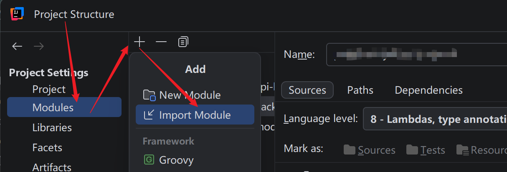

## Table of contents

## Maven

1. 下载 maven 的 zip 解压，略
2. 将 maven 目录的 bin 文件夹添加到环境变量，略
3. 配置 maven 的 settings.xml 文件，如下
4. IDEA 配置 maven，略

```xml
<!-- 本地仓库存储路径 -->
<localRepository>D:\Maven\apache-maven-3.9.11\mvn_repo</localRepository>

<!-- Aliyun 镜像 -->
<mirror>
  <id>alimaven</id>
  <name>aliyun maven</name>
  <url>http://maven.aliyun.com/nexus/content/groups/public/</url>
  <mirrorOf>central</mirrorOf>
</mirror>
```

让 IDEA 识别已有 Maven 项目，如果在 IDEA 中未识别到当前项目为 Maven 项目，则按如下所示导入对应项目的 pom.xml 文件即可



### 排除依赖

一个 jar 包会依赖多个 jar 包，如果不需要这个 jar 包下的某个依赖，则可以使用 `exclusions` 指定排除

```xml
<dependency>
  <groupId>org.apache.commons</groupId>
  <artifactId>commons-lang3</artifactId>
  <version>3.12.0</version>
  <!-- 排除依赖 -->
  <exclusions>
    <exclusion>
      <artifactId>commons-logging</artifactId>
      <groupId>commons-logging</groupId>
    </exclusion>
  </exclusions>
</dependency>
```

### 依赖范围

依赖的 jar 包，默认情况下可以在任何地方使用，可通过 `<scope>...</scope>` 来约束其运行范围

| 范围            | 主程序 | 测试程序 | 打包（运行） | 范例        |
| --------------- | ------ | -------- | ------------ | ----------- |
| compile（默认） | Y      | Y        | Y            | log4j       |
| test            | -      | Y        | -            | junit       |
| provided        | Y      | Y        | -            | servlet-api |
| runtime         | -      | Y        | Y            | jdbc 驱动   |

```xml
<dependency>
  <groupId>junit</groupId>
  <artifactId>junit</artifactId>
  <version>4.13.2</version>
  <scope>test</scope>
</dependency>
```

## SpringBoot 基础

正常前后端分离都是创建 SpringBoot 项目，在 3.x 中，集成的是 `spring-boot-starter-web`，在 4.x 中划分更细致，starter-web 被废弃改为了 `spring-boot-starter-webmvc`。具体 3.x -> 4.x 的变更可查看 [Spring Boot 3 到 4 迁移完全指南：新特性、废弃功能与实战踩坑经验](https://zhuanlan.zhihu.com/p/1985777511553060965)

最基础的 SpringBoot Rest Api 代码

```java
// curl -X GET http://localhost:8080/hello?name=xiaoming
// curl.exe -X GET "http://localhost:8080/hello?name=xiaoming"
@RestController
public class BaseController {

    @GetMapping("/hello")
    public String hello(String name) {
        return "hello world: " + name;
    }
}
```

获取 http 请求数据，通过 `HttpServletRequest` 获取

```java
// curl -X GET http://localhost:8080/hello?name=xiaoming
@GetMapping("/hello")
public HashMap<String, String> hello(HttpServletRequest request) {
    HashMap<String, String> map = new HashMap<>();
    map.put("name", request.getParameter("name"));
    map.put("uri", request.getRequestURI());
    map.put("url", request.getRequestURL().toString());
    map.put("protocol", request.getProtocol());
    map.put("method", request.getMethod());
    map.put("userAgent", request.getHeader("User-Agent"));
    map.put("queryString", request.getQueryString());
    return map;
}
/**
{
  "protocol": "HTTP/1.1",
  "method": "GET",
  "name": "xiaoming",
  "userAgent": "Mozilla/5.0 (Windows NT 10.0; Win64; x64) AppleWebKit/537.36 (KHTML, like Gecko) Chrome/152.0.0.0 Safari/537.36",
  "queryString": "name=xiaoming",
  "uri": "/hello",
  "url": "http://localhost:8080/hello"
}
 */
```

设置响应 http 请求，有两种方式：通过 `HttpServletResponse` 或 `ResponseEntity` 设置

```java
// curl -X GET http://localhost:8080/hello
// 手动设置返回的数据类型是 text/html，让浏览器直接以 html 解析响应数据
@GetMapping("/hello")
public void hello(HttpServletResponse response) {
    // 设置响应状态码 通常不需要指定
    // response.setStatus(HttpServletResponse.SC_OK);
    // 设置响应头
    response.setHeader("Content-Type", "text/html");
    // 设置响应字符编码
    response.setCharacterEncoding("UTF-8");
    try {
        response.getWriter().write("<h1 style='color: red;'>你好江小白</h1>");
    } catch (IOException e) {
        throw new RuntimeException(e);
    }
}

// 等价于
@GetMapping("/hello")
public ResponseEntity<String> hello() {
    return ResponseEntity
            .status(200)
            // 也可以使用 header 设置
            .contentType(new MediaType("text", "html", StandardCharsets.UTF_8))
            .body("<h1 style='color: red;'>你好江小白</h1>");
}
```

### Spring 三层架构

一个常规的 SpringBoot 项目，通过 Controller -> Service -> Dao 三层架构来控制数据的访问。Controller 主要处理 http 请求，Service 主要处理业务逻辑，Dao 主要处理数据访问。

传统的三层架构写法（非推荐写法）

```java
@RestController
public class UserController {
    private UserService userService = new UserService();

    @GetMapping("/user")
    public String user() {
        return userService.getName();
    }
}


public class UserService {
    private UserDao userDao = new UserDao();

    public String getName() {
        return userDao.findName();
    }
}

public class UserDao {
    public String findName() {
        return "xiaoming";
    }
}
```

上边这段代码，通过 new 创建对象，Controller 和 Service 强耦合，Service 和 Dao 强耦合，一旦 Dao 层发生改变，会影响 Controller 层，Controller 层代码也会被修改。

举个例子，现在 Dao 层需要连接数据库而不是纯字符串了

```java
public class UserDao {
    private DataSource dataSource;

    public UserDao(DataSource dataSource) {   // ← 新增参数
        this.dataSource = dataSource;
    }

    public String findName() {
        // 从数据库查...
    }
}

// ⬇ 连锁 Service
public class UserService {
    private DataSource dataSource;

    public UserService(DataSource dataSource) {  // ← 被迫加参数，往下透传
        this.dataSource = dataSource;
    }

    private UserDao userDao = new UserDao(dataSource);\

    public String getName() {
        return userDao.findName();
    }
}

// ⬇ 连锁 Controller
@RestController
public class UserController {
    private DataSource dataSource = ...;  // ← Controller 居然要关心数据源！
    private UserService userService = new UserService(dataSource);

    @GetMapping("/user")
    public String user() {
        return userService.getName();
    }
}
```

这是一个典型的连锁反应，违反依赖倒置，且手动 new 的无法被 Spring Bean 管理，无法使用 @Transactional 等注解

### IOC 控制反转和 DI 依赖注入

Spring Boot 通过 IOC 容器管理对象的创建与依赖关系：类不再自己 new 依赖，而是声明需要什么，由容器自动注入（DI）。

示例代码中 `@Service` `@Repository` 就是 IOC 容器管理的对象，通过 `@Autowired` 注解注入对象。

Spring 启动时，会扫描 `@Component` 以及所有派生注解，包括：`@Component` `@Service` `@Repository` `@Controller` `@RestController` `Configuration` 等等，这些注解修饰的类会被加入 IOC 容器并注册为 Bean

```java
@RestController
public class UserController {
    @Autowired
    private UserService userService;

    @GetMapping("/user")
    public String user() {
        return userService.getName();
    }
}

@Service
public class UserService {
    @Autowired
    private UserDao userDao;

    public String getName() {
        return userDao.findName();
    }
}

@Repository
public class UserDao {
    public String findName() {
        return "xiaoming";
    }
}
```

如果 Dao 需要连接数据库

```java
@Repository
public class UserDao {
    private JdbcTemplate jdbcTemplate;   // IOC 容器会自动注入

    public UserDao(JdbcTemplate jdbcTemplate) {
        this.jdbcTemplate = jdbcTemplate;
    }

    public String findName() {
        return jdbcTemplate.queryForObject(
                "select name from user where id = 1", String.class);
    }
}
```

### DI

例如 `@Autowired` 有三种注入方式：属性注入、构造函数注入、方法注入

Spring 官方推荐第二种构造函数注入，但是大部分企业项目开发中，为了代码的简洁性而会使用第一种属性注入

- 属性注入 优点是代码简介，缺点是无法清晰描述依赖关系，可能会破坏类的封装性（getter/setter）
- 构造函数注入 优点是清晰描述依赖关系，缺点是代码较多
- 方法注入一般没人使用

```java
// 属性注入
@RestController
public class UserController {
    @Autowired
    private UserService userService;
    // ...
}

// 构造函数注入
@RestController
public class UserController {
    private final UserService userService;
    @Autowired // 当前类只有一个构造函数时，@Autowired 可省略
    public UserController(UserService userService) {
        this.userService = userService;
    }
}

// 方法注入
@RestController
public class UserController {
    private UserService userService;
    @Autowired
    public void setUserService(UserService userService) {
        this.userService = userService;
    }
}
```

`@Autowired` 是按照类型注入的，如果一个接口被多个类实现，默认情况下，Spring 是不知道需要注入哪个 Bean 的。

- `public class UserServiceImpl implements UserService {}`
- `public class UserServiceImpl2 implements UserService {}`

使用以下三种方式解决。

```java
@Primary
@Service
public class UserServiceImpl implements UserService {
  //...
}

// 或者
@Autowired
@Qualifier("userServiceImpl2")
private UserService userService;

// 或者
@Resource(name = "userServiceImpl2")
private UserService userService;
```

## Mysql

### DDL 表操作

创建表

```sql
#
-- 用户表 InnoDB 引擎，自增从 1 开始，默认字符集为 utf8mb4 主键为 id
CREATE TABLE `user` (
  `id` int NOT NULL AUTO_INCREMENT COMMENT '用户id',
  `name` varchar(255) DEFAULT NULL UNIQUE COMMENT '用户名',
  `age` int DEFAULT NULL UNSIGNED COMMENT '用户年龄',
  `sex` tinyint DEFAULT NULL COMMENT '用户性别 1:男 2:女',
  PRIMARY KEY (`id`)
) ENGINE=InnoDB AUTO_INCREMENT=1 DEFAULT CHARSET=utf8mb4 COMMENT='用户表';
```

> `FOREIGN KEY` 是强关联外键，通常在实际业务中不使用。`TINYINT  UNSIGNED` 是非负整数（0 ~ 255）没有这个约束是（-128 ~ 127）

查询、添加、删除表结构

```sql
show tables; -- 查询当前数据库所有表
desc 表名; -- 查询表结构
show create table 表名; -- 查询建表语句

alter table 表名 add 字段名 字段类型（长度） [comment 注释] [约束]; -- 添加字段
alter table 表名 modify 字段名 字段类型（长度）; -- 修改字段
alert table 表名 change 旧字段名 新字段名 字段类型（长度）[comment 注释] [约束]; -- 修改字段名与字段类型
alter table 表名 drop column 字段名; -- 删除字段
alter table 表名 rename to 新表名; -- 重命名表

drop table [if exists] 表名; -- 删除表
```

### DML 数据操作

insert

```sql
-- 对指定字段添加数据
insert into 表名 (字段1, 字段2, ...) values (值1, 值2, ...);

-- 添加所有字段的数据
insert into 表名 values (值1, 值2, ...);

-- 批量添加数据（指定字段）
insert into 表名 (字段1, 字段2, ...) values (值1, 值2, ...), (值1, 值2, ...), (值1, 值2, ...);

-- 批量添加数据（所有字段）
insert into 表名 values (值1, 值2, ...), (值1, 值2, ...), (值1, 值2, ...);
```

update 如果没有 where 条件，则更新表中所有数据

```sql
update 表名 set 字段1 = 值1, 字段2 = 值2, ... where 条件;
```

delete 如果没有 where 条件，则删除表中所有数据

```sql
delete from 表名 where 删除条件;
```

### DQL 查询数据

#### 基础查询

```sql
-- 查询所有字段（通配符）
select * from 表名;

-- 查询指定字段
select 字段1, 字段2, ... from 表名;

-- 添加别名
select 字段1 [as 别名1], 字段2 [as 别名2], ... from 表名;

-- 去除重复数据
-- 如果是多个字段，则必须符合这多个字段组合起来的值重复
select distinct 字段1, 字段2, ... from 表名;
```

#### 条件查询

| 运算符              | 描述                                     |
| ------------------- | ---------------------------------------- |
| =                   | 等于                                     |
| <> 或 !=            | 不等于                                   |
| >                   | 大于                                     |
| <                   | 小于                                     |
| >=                  | 大于等于                                 |
| <=                  | 小于等于                                 |
| BETWEEN ... AND ... | 在某个范围之间（含最小值和最大值）       |
| IN(...)             | 在某个集合中                             |
| LIKE                | 模糊匹配 `%`（任意字符） `_`（单个字符） |
| IS NULL             | 为 NULL                                  |
| IS NOT NULL         | 不为 NULL                                |
| and 或 &&           | 且                                       |
| or 或               | 或                                       |
| not 或 !            | 非                                       |

```sql
select * from 表名 where 逻辑表达式;

SELECT * FROM student WHERE gender = '男';      -- 等于
SELECT * FROM student WHERE gender <> '男';     -- 不等于
SELECT * FROM student WHERE gender != '男';     -- 不等于
SELECT * FROM student WHERE age > 18;           -- 大于
SELECT * FROM student WHERE age < 18;           -- 小于
SELECT * FROM student WHERE score >= 60;        -- 大于等于
SELECT * FROM student WHERE score <= 90;        -- 小于等于

-- BETWEEN ... AND ...：含最小值和最大值
SELECT * FROM student WHERE age BETWEEN 18 AND 20;
-- IN：在某个集合中
SELECT * FROM student WHERE class_id IN (1, 2, 3);

-- 以“张”开头
SELECT * FROM student WHERE name LIKE '张%';
-- 包含“小”
SELECT * FROM student WHERE name LIKE '%小%';
-- “张”后面只有一个字 张三符合，张麻子不符合
SELECT * FROM student WHERE name LIKE '张_';

SELECT * FROM student WHERE email IS NULL;      -- 为 NULL
SELECT * FROM student WHERE email IS NOT NULL;  -- 不为 NULL

-- AND / &&：且
SELECT * FROM student WHERE gender = '男' AND score >= 80;
SELECT * FROM student WHERE gender = '男' && score >= 80;

-- OR / ||：或
SELECT * FROM student WHERE class_id = 1 OR score >= 90;
SELECT * FROM student WHERE class_id = 1 || score >= 90;
-- NOT / !：非
SELECT * FROM student WHERE NOT (gender = '男' OR gender = '未知');
SELECT * FROM student WHERE !(gender = '男');
```

#### 分组查询

分组查询一般和聚合函数一起使用

`select 聚合函数(字段) from 表名 [where 条件] group by 分组字段 [having 聚合函数条件];`

| 聚合函数 | 描述                                    |
| -------- | --------------------------------------- |
| count()  | 统计行数，如果字段为 NULL，则不参与统计 |
| sum()    | 求和，如果字段为 NULL，则返回 NULL      |
| avg()    | 平均值，如果字段为 NULL，则返回 NULL    |
| max()    | 最大值，如果字段为 NULL，则返回 NULL    |
| min()    | 最小值，如果字段为 NULL，则返回 NULL    |

聚合函数基础示例

```sql
SELECT COUNT(*) FROM student;        -- 统计总行数
SELECT COUNT(email) FROM student;    -- 统计 email 非空的行数
SELECT SUM(score) FROM student;      -- 成绩总和
SELECT AVG(score) FROM student;      -- 成绩平均值
SELECT MAX(score) FROM student;      -- 成绩最大值
SELECT MIN(score) FROM student;      -- 成绩最小值
```

分组 GROUP BY 基础示例

```sql
-- 按性别分组，统计每组人数
SELECT gender, COUNT(*) AS num
FROM student
GROUP BY gender;

-- 按班级分组，统计每班人数、平均分、最高分
SELECT class_id, COUNT(*) AS num, AVG(score) AS avg_score, MAX(score) AS max_score
FROM student
GROUP BY class_id;
```

多字段分组

```sql
-- 按班级和性别分组，统计每个班、男女分别多少人
SELECT class_id, gender, COUNT(*) AS num
FROM student
GROUP BY class_id, gender;
```

WHERE 与 HAVING

- WHERE：分组前过滤行，不能使用聚合函数。
- HAVING：分组后过滤组，可以使用聚合函数。

```sql
-- 查询班级 1、2、3、4班 中，平均分大于 80 的班级
SELECT class_id, AVG(score) AS avg_score
FROM student
WHERE class_id IN (1, 2, 3, 4)
GROUP BY class_id
HAVING AVG(score) > 80;
```

#### 排序查询

在分组查询的查询语句后跟上 `ORDER BY 字段 [ASC | DESC]`，不指定排序默认升序（ASC）

```sql
-- 多字段排序，按 score 升序、按 name 降序
SELECT * FROM student ORDER BY score ASC, name DESC;
```

#### 分页查询

基于排序查询的 ORDER BY 之后再跟 LIMIT 语法实现分页，`LIMIT 起始索引, 查询数量`，就是第几页，查几条

```sql
-- 查询第 1 页，每页 10 条 数据按 score 降序
SELECT * FROM student ORDER BY score DESC LIMIT 1, 10;
```

## MyBatis

严格来对比的话，MyBatis 就是 node 端的 drizzle，MyBatis-Plus 就是 node 端的 prisma，就是个 ORM 框架

1. 引入 maven 依赖：mysql 驱动、mybatis 依赖、lombok

```xml
<dependency>
    <groupId>org.mybatis.spring.boot</groupId>
    <artifactId>mybatis-spring-boot-starter</artifactId>
    <version>4.0.1</version>
</dependency>
<dependency>
    <groupId>com.mysql</groupId>
    <artifactId>mysql-connector-j</artifactId>
    <scope>runtime</scope>
</dependency>
<dependency>
    <groupId>org.projectlombok</groupId>
    <artifactId>lombok</artifactId>
    <optional>true</optional>
</dependency>
```

2. 连接数据库

```yml
# application.yml
spring:
  datasource:
    url: jdbc:mysql://192.168.52.128:3306/db_name?useSSL=false&serverTimezone=UTC&characterEncoding=utf8
    username: root
    password: 123456
    driver-class-name: com.mysql.cj.jdbc.Driver
```

3. 创建数据库对应的实体类（getter/setter/无参构造/空参构造）和 Mapper 层

```java
@Data
@AllArgsConstructor
@NoArgsConstructor
public class User {
  private Integer id;
  private String name;
  private Integer age;
  //...
}

@Mapper
public interface UserMapper {
  @Select("select * from user")
  public List<User> findAllUser();
}
```

4. 在测试类中测试是否正常工作

```java
@SpringBootTest
class SpringMybatisApplicationTests {

    @Autowired
    private UserMapper userMapper;

    @Test
    void testFindAllUser() {
        List<User> userList = userMapper.findAllUser();
        userList.forEach(item -> {
            System.out.printf(item.getUsername() + ", ");
        });
    }
}
```

### 配置

application.yml 的配置具体看[文档](https://mybatis.org/spring-boot-starter/mybatis-spring-boot-autoconfigure/zh_CN/index.html)就行
